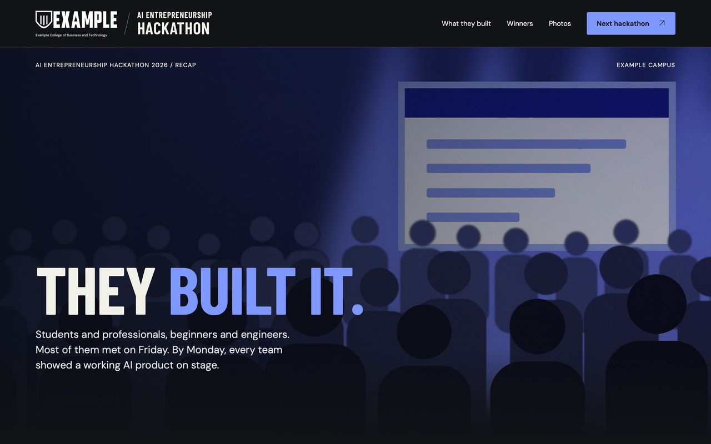
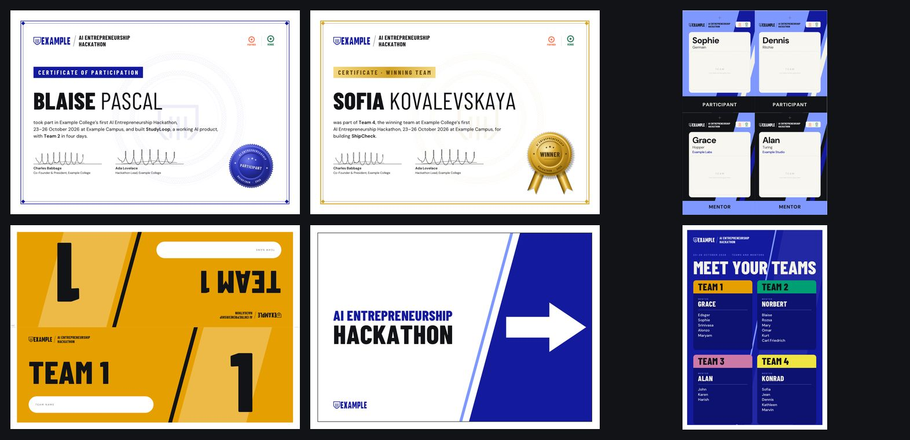
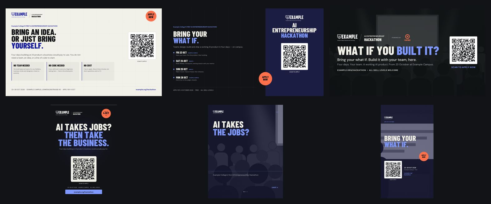
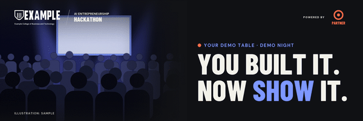
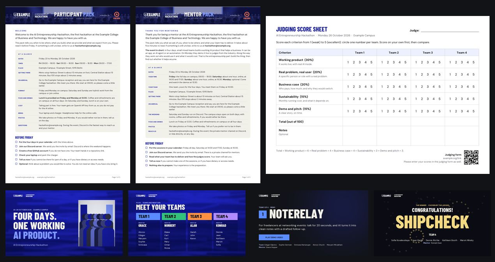
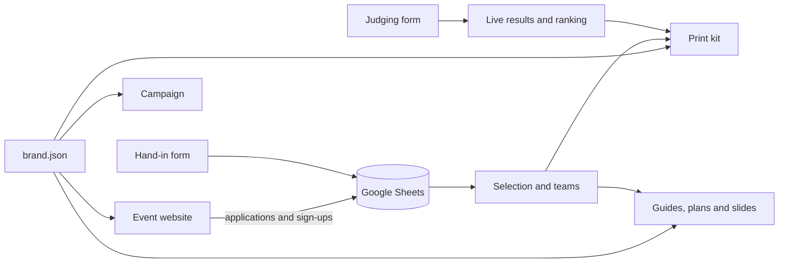

# hackathon-os

**Everything it took to run a real hackathon, as code.** Applications, team documents, judging,
certificates, slides, posters, emails and the playbook, in one repository that runs end to end on
fake data.

Built for the AI Entrepreneurship Hackathon at
[Berlin College of Business and Technology](https://berlincollege.de/hackathon), October 2026:
four days, 19 participants, four teams, four working products.

Designed and run by **Pezhman Asadi**.



## What's inside

| Folder | What it does |
|---|---|
| [`backend/`](backend) | Applications, sign-ups, hand-in and live judging on Google Apps Script, with no server to run |
| [`website/`](website) | The event site, with a one-command build for WordPress |
| [`print-kit/`](print-kit) | Badges, stickers, signs and certificates from a few CSV files |
| [`documents/`](documents) | Guides, staff and mentor plans, slide decks and calendar files |
| [`marketing/`](marketing) | Posters, venue screens, Instagram sets and animated email banners |
| [`brand/`](brand) | One file for colours, fonts and logos, used by every tool |
| [`playbook/`](playbook) | How to run a hackathon, week by week, with runbooks and the traps to avoid |
| [`sample-data/`](sample-data) | Fake people and generated pictures, so everything runs |

## Try it

You need Python 3.14.

```bash
pip install -r requirements.txt
python tools/build_all.py
```

About 25 seconds later, `output/` holds more than 100 files: print-ready PDFs, Word files, editable
PowerPoint decks, calendar files and an animated GIF. To see the website, open
[`website/index.html`](website/index.html) in a browser. Its forms run in preview mode and send nothing.

### Print kit



### Campaign





### Documents and slides



## How it fits together



## Engineering notes

- **No server.** Google Sheets is the database and Apps Script is the backend.
- **Safe retries.** A resent form updates its row instead of filing someone twice.
- **Preview cannot reach production.** A live build refuses to run without real endpoints, and
  strips the preview banner from the markup so link previews never show it.
- **One source, many formats.** A pack's words render to PDF, Word and PowerPoint from one file.
- **Layouts check themselves.** Overlaps, unsafe margins and crowded QR codes are reported at build
  time, and a bad row in a CSV stops the print run with the file and line number.
- **Tested.** 31 tests cover the Apps Script backend, scoring, calendars, builds and the privacy check.

## Privacy

This repository contains no real participant data. The people are historical computing and maths
pioneers used as placeholders, the college is made up, and every picture is drawn by code.
[`tools/privacy_check.py`](tools/privacy_check.py) runs in CI and fails on real-looking emails,
phone numbers, private links, keys, image metadata or unknown names in the sample lists.

## Use it for your own event

1. Set your colours, fonts and logos in [`brand/brand.json`](brand/brand.json).
2. Copy the CSV files from [`sample-data/print-kit`](sample-data/print-kit) to a private folder, fill
   them in, and set `PRINT_KIT_DATA` to that folder.
3. Update the dates and wording. They live in each tool's content, such as
   [`documents/content.py`](documents/content.py).
4. Deploy the [`backend/`](backend) scripts and build the [`website/`](website) with your endpoints.
5. Follow the [playbook](playbook).

## Licence

Code: [MIT](LICENSE). Fonts: SIL Open Font License, see [`brand/fonts`](brand/fonts).
